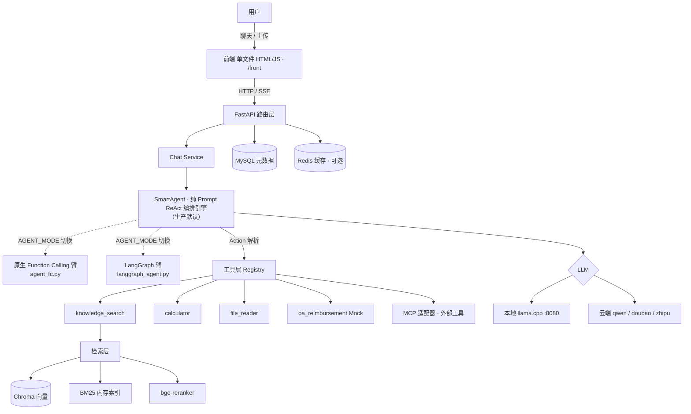

# 本地化 ReAct Agent 系统

> **RAG 检索增强 + 多工具编排 + 自建评测的本地化 Agent。**
> 基于自研 ReAct 编排引擎，并排实现 Prompt ReAct / 原生 Function Calling / LangGraph 三种编排范式并做同条件 A/B 对照，通过 MCP 协议接入外部工具；全链路可跑在本地（llama.cpp + bge 系列模型），**知识库数据不出网**，面向私有化办公场景。

---

## 目录

- [项目简介](#项目简介)
- [演示视频](#演示视频)
- [核心特性](#核心特性)
- [架构概览](#架构概览)
- [技术栈](#技术栈)
- [快速开始](#快速开始)
- [多范式编排（ReAct / FC / LangGraph 对照）](#多范式编排react--fc--langgraph-对照)
- [评测体系](#评测体系)
- [目录结构](#目录结构)
- [部署](#部署)
- [已知限制](#已知限制)
- [许可证](#许可证)

---

## 项目简介

这是一个**能自主编排工具的 Agent**，而非固定流水线的问答助手。给定用户问题，Agent 会自主决定「检索知识库 / 调计算器 / 读文件 / 走 OA 流程」的组合顺序，循环多轮直到给出答案。

项目的核心亮点：
1. **自建评测体系**——受控变量、断点续跑、可复现的端到端 + 检索层双轨指标。
2. **多范式工具编排**——同一套工具层上并排实现 Prompt ReAct / 原生 Function Calling / LangGraph 三种编排，并用同一评测做 A/B 对照。
3. **RAG 检索增强**——向量 / BM25 / 混合 / HyDE 多策略 + bge-reranker 重排 + Query 改写。

> 演示场景：企业内部办公私有化 Agent（本地大模型 + 本地向量库）。

## 演示视频


> 点击上方播放查看完整演示：Agent 自主编排知识检索 / 计算器 / 文件读取 / OA 流程工具，多轮推理后给出答案（全部在本地 llama.cpp + Qwen2.5-7B 上运行，数据不出网）。

---

## 核心特性

- **多策略检索**：向量（vector）/ BM25 / 混合（hybrid，RRF 融合）/ HyDE，支持 bge-reranker 重排。
- **智能 Query 改写**：与检索策略正交的查询增强层（none/hyde/expand/decompose），默认关闭。
- **ReAct Agent**：`SmartAgent` 流式输出、循环检测、上下文压缩，可自主编排 `knowledge_search` / `calculator` / `file_reader` / `oa_reimbursement` 等工具。
- **多范式编排引擎**：通过 `AGENT_MODE` 在 ReAct / 原生 Function Calling / LangGraph 三套编排间切换（详见[架构文档](docs/ARCHITECTURE.md)）。
- **MCP 适配层**：自写通用适配器，把内置工具动态注册到 MCP server，支持通过 MCP 协议接入外部工具。
- **知识库管理**：协作者权限、文档上传四步流程、分块预览。
- **评测体系**：检索层指标（P@k / R@k / F1 / MRR / NDCG / Ragas）+ Agent 端到端指标（答案匹配 / 工具正确率 / 幻觉率）。
- **鉴权**：JWT + bcrypt。
- **私有化友好**：默认 `local` provider 走本地 llama.cpp，`LOCAL_MODEL_BASE_URL` 指向 `http://localhost:8080/v1`，知识库数据不出机。

---

## 架构概览



> 说明：生产流量默认走 **ReAct（SmartAgent）** 编排；原生 Function Calling 与 LangGraph 是并排实现的对照臂，通过 `AGENT_MODE` 在评测中启用，用于验证「编排架构在小模型上不是决定性因素」（详见[评测体系](#评测体系)）。

---

## 技术栈

- **后端**：FastAPI + SQLAlchemy（async）+ Chroma（向量）+ MySQL（元数据）+ Redis（缓存，可选）
- **Agent 编排**：自研 ReAct 编排引擎；LangChain-core（`ChatOpenAI` / `StructuredTool`）作为 LLM 客户端；LangGraph 用于对照实验
- **检索**：sentence-transformers（bge 系列）+ chromadb + jieba（BM25）
- **前端**：`front/` 单文件内联 HTML/JS（多入口：`index.html` 工作台、`agent.html` 等）
- **模型**：本地 llama.cpp 提供 qwen2.5-7b（q5_k_m）OpenAI 兼容接口 + bge-large-zh-v1.5 嵌入 + bge-reranker-v2-m3 重排

---

## 快速开始

> 前置依赖：Python 3.11+、MySQL 8.0（必需）、Redis 7（可选）、llama.cpp（本地 LLM，监听 `:8080`）。完整说明见 **[docs/DEPLOY.md](docs/DEPLOY.md)**。

```bash
# 0. 克隆
git clone https://github.com/lingyun0305/rag-agent.git RAG-ai_chat && cd RAG-ai_chat

# 1. 配置环境变量
cp .env.example .env
#    填 SECRET_KEY；本地手动跑 api 时 MySQL 用 rag_agent / rag_agent_pw / rag_agent_db

# 2. 一键起 api + mysql + redis
docker-compose up -d

# 3. 另开终端起本地大模型 llama.cpp :8080（详见 docs/DEPLOY.md）
#    加载 qwen2.5-7b-q5_k_m；验证：curl http://localhost:8080/props

# 4. 打开
#    http://localhost:8000/front/index.html
```

> 想本地手动跑（venv + uvicorn 而非容器化 api）、或需 llama.cpp / `.env` 逐项配置说明，见 **[docs/DEPLOY.md](docs/DEPLOY.md)**。

---

## 多范式编排（ReAct / FC / LangGraph 对照）

系统在同一套工具层之上并排实现了三种编排范式，通过环境变量 `AGENT_MODE` 切换（详见 [docs/ARCHITECTURE.md](docs/ARCHITECTURE.md)）：

| 范式 | 机制轴 | 循环引擎轴 | 代码位置 |
|---|---|---|---|
| **ReAct**（生产默认） | Prompt + 正则解析文本 | 手写 `while` | `backend/app/agent/agent.py` |
| **原生 Function Calling** | 原生 `tool_calls` | 手写 `while` | `backend/app/agent/agent_fc.py` |
| **LangGraph** | 原生 `tool_calls` | `StateGraph` | `backend/app/agent/langgraph_agent.py` |

三臂通过**两正交轴**解耦，使对照实验每次只变一个变量；三者均**未使用** LangChain `AgentExecutor`（仅用 `ChatOpenAI` 作 LLM 客户端）。生产路径保留自研编排层，以获得可控性、可观测性与对 7B 小模型的可靠性。

---

## 评测体系

端到端评测套件 `backend/eval/run_eval.py` + `backend/eval/testset.json`：**70 条用例 / 9 类**（knowledge_query 20、calculation 10、no_answer 8、mixed 7、tool_call 7、long_dialog 6、fuzzy_query 5、hallucination 4、file_read 3），支持按类型过滤、断点续跑、分轮次追加报告。

### 三臂同条件对照（同机·同 70 例·POST-404 干净数据，2026-10-17）

> **变量对齐**：三臂现已全部处于**无 KB cap** 状态——ReAct 原生无 cap；FC/LG 的检索原文字符截断（`KB_PER_RESULT_CAP=1800`/`KB_BLOCK_CAP=5500`）已于 2026-10-17 移除。故下表为消除"FC/LG 有 cap、ReAct 无 cap"混杂后的单变量对比。

| 编排范式 | 综合分 | 答案匹配 | 工具准确率 | 幻觉率 |
|---|---|---|---|---|
| ReAct（默认） | 95.14 | 90.00% | 100.00% | 4.29% |
| LangGraph | 91.86 | 86.43% | 97.14% | 7.86% |
| 原生 Function Calling | 90.29 | 82.86% | 97.14% | 8.57% |

**核心结论**：
- 排序 **ReAct 95.14 > LG 91.86 > FC 90.29**（极差约 4.85pt）。ReAct领先主因是**编排格式**——手写 ReAct 的显式 text-trace 比原生 FC/LangGraph 的 tool-message 格式更把 7B 锚定在多跳推理上。
- **方差提示**：三臂现均已**双跑取均值**（ReAct 双跑同分；FC/LG 各两跑，跨度分别 1.71pt / 3.71pt）。LG 在 7B 上的稳定性弱于 FC（跨度更大），但 FC/LG 均值差仅 1.57pt、落于 7B 方差带内——可表述为「ReAct 明显领先，FC/LG 接近且可用，LG 均值略高但不显著」。

```bash
# 端到端（需 LLM / embedding / 向量库 / MySQL 在线）
$env:LLM_PROVIDER="local"; $env:PYTHONPATH="."; $env:HF_HUB_OFFLINE=1
venv/Scripts/python.exe backend/eval/run_eval.py                 # 默认 react
$env:AGENT_MODE="fc";       venv/Scripts/python.exe backend/eval/run_eval.py
$env:AGENT_MODE="langgraph"; venv/Scripts/python.exe backend/eval/run_eval.py

# 检索层多策略 / 多阈值对比
venv/Scripts/python.exe backend/eval/run_rag_eval.py --threshold 0,0.1,0.3,0.5,0.7
```

> 报告 JSON 与汇总在 `backend/eval/reports/`。

---

## 目录结构

```
backend/
  main.py                  # FastAPI 入口（backend.main:app）
  app/
    agent/                 # 编排引擎：agent.py(ReAct) / agent_fc.py(FC) / langgraph_agent.py / agent_state.py
      tools/               # 工具层：registry / base / knowledge_search / calculator / file_reader / oa_mock / mcp_adapter
      memory/              # 长期记忆
      context/             # 上下文压缩
    rag/                   # 检索服务 / Query 改写 / BM25 / HyDE
    router/                # API 路由（chat / auth / knowledge / agent / upload）
    services/              # 业务逻辑（chat / agent_chat / knowledge）
    core/                  # config.py（环境变量） / cache（Redis）
    models/                # ORM 模型
  eval/                    # 评测：run_eval.py（端到端 70 条）/ run_rag_eval.py（检索层）/ reports/
  db/                      # 数据库连接 / 建表
  prompts/                 # 提示词模板（agent_system v1~v4 / hyde / rag / rewrite / struct）
front/                     # 前端单文件（index.html 工作台、agent.html 等）
knowledge_files/           # 知识库原始文件
chroma_db/                 # Chroma 向量持久化
docs/                      # ARCHITECTURE.md（架构）/ DEPLOY.md（部署）
docker-compose.yml         # api + mysql + redis 一键编排
Dockerfile
```

---

## 部署

见 **[docs/DEPLOY.md](docs/DEPLOY.md)**：

- 方式 A：`docker-compose up -d`（api + mysql + redis 一键）
- 方式 B：本地手动（venv + llama.cpp 本地模型 + MySQL + 可选 Redis）
- `.env` 逐项配置说明、生产化建议（反向代理 / 资源 / 私有化）、运维（健康检查 `/health`、`/metrics`）

---

## 已知限制

- **MySQL 为硬依赖**：元数据 / 用户 / 工具注册走 `mysql+aiomysql`，无 SQLite 兜底，启动需 MySQL 在线。
- **Redis 为可选**：连接失败时自动降级为内存缓存（见 `backend/app/core/cache.py`）。
- **多范式对照臂**：原生 Function Calling 与 LangGraph 主要用于评测对照；生产默认走 ReAct（SmartAgent）。
- **`oa_reimbursement` 为 Mock 连接器**：部署到真实环境需替换为真实 OA HTTP 连接器。
- **BM25 为内存索引**：服务重启后丢失，已通过懒重建机制从 Chroma 回填。
- **弱模型心算风险**：7B 可能绕过 calculator 直接心算；兜底 = prompt 数值计算铁律 + 心算闸（`_should_enforce_calculator` 正则扫答案中的数字，未调 calculator 即拦截重跑）。
- **检索调参提示**：关注 `vecTop`（向量余弦分，上限 ~0.47），不要看 `top_score`（rerank 分，量纲约 0.01–0.92）。

---

## 许可证

见 [LICENSE](LICENSE)。
